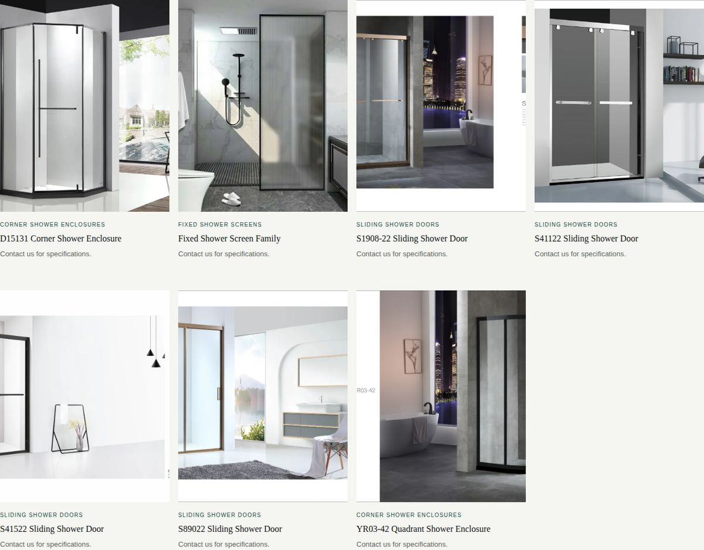
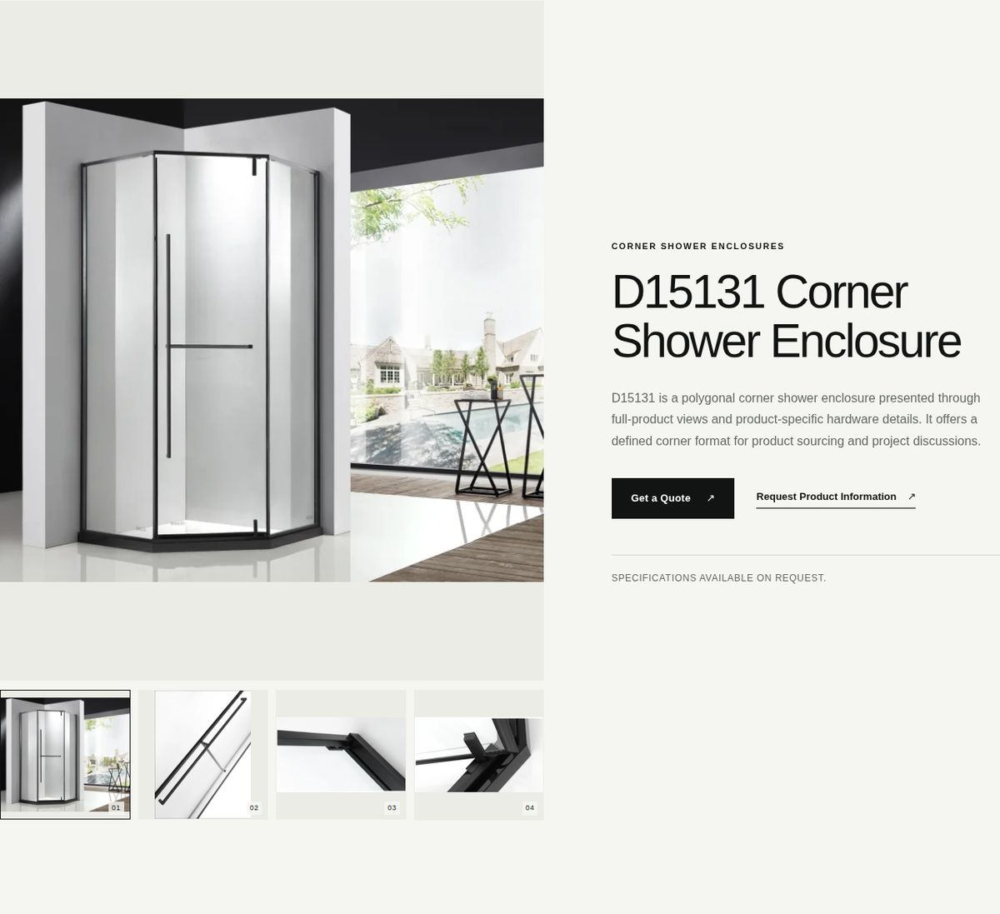
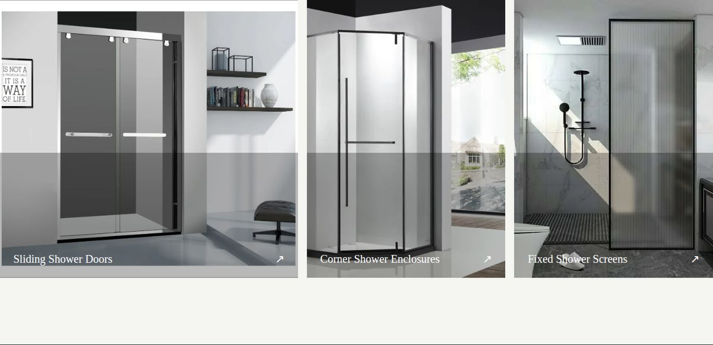

# Dulifei Website Audit

As of 2026-10-12. Audited: the live site at https://01showerenclosure-production.up.railway.app (team's upstream `main`). Shared doc version: https://claude.ai/artifact/6Y8PtmhGFz7HZFgTdknP9V (private unless shared).

The live site passes Google's basic checks, but AI search tools see an empty page and phones wait about 4 seconds for the main content. Both come from how the site delivers its pages, so the fix is a rebuild of that layer, not more patches.

## At a glance

Two areas fail outright, both tied to search, which is the site's main goal.

| Area | Status | Evidence |
| --- | --- | --- |
| AI search visibility (GEO) | Fail | Every URL returns the same 737-byte page with 3 words of text. Content appears only after JavaScript runs. |
| Search setup | Fail | No sitemap, robots.txt, page descriptions, structured data or social preview image. Pages that don't exist return "OK" instead of "not found". |
| Mobile speed | Needs work | Main content appears after 3.6 to 4.3 s on a phone (Google's "good" is under 2.5 s). The main script is sent uncompressed: 313 KB instead of about 94 KB. |
| Visual consistency | Needs work | The two brand fonts never load, so visitors get Arial and Times New Roman. Product photos differ in crop, background and quality. |
| Lead capture | Needs work | No phone, email or WhatsApp anywhere on the site. The only way to reach sales is the form on the Contact page. |
| Code upkeep | Needs work | All pages live in one file, and every dependency is set to "latest", so a future build can break without any code change. |
| Google basics | Pass | Lighthouse scores 100 for SEO, accessibility and best practices on all three pages tested. |

## What search engines and AI tools see

Every page sends the same empty shell, and the real text only appears after the browser runs a 313 KB script. Google can run that script, which is why Lighthouse scores 100. The AI crawlers behind ChatGPT, Claude and Perplexity do not run JavaScript ([Vercel, Dec 2024](https://vercel.com/blog/the-rise-of-the-ai-crawler)), so to them the site has no products, no company and no text.

| URL | Raw page size | Title in the raw page | Words of text |
| --- | --- | --- | --- |
| / | 737 bytes | Dulifei Shower Enclosures | 3 |
| /products | 737 bytes | Dulifei Shower Enclosures | 3 |
| /products/corner-shower-enclosures/d15131-corner-shower-enclosure | 737 bytes | Dulifei Shower Enclosures | 3 |
| /factory | 737 bytes | Dulifei Shower Enclosures | 3 |
| /about | 737 bytes | Dulifei Shower Enclosures | 3 |
| /contact | 737 bytes | Dulifei Shower Enclosures | 3 |

Also missing for search:

- robots.txt, sitemap.xml and llms.txt all return 404.
- No raw page carries a meta description, canonical link, social preview image or structured data (Organization, Product).
- A URL that doesn't exist returns HTTP 200 with the homepage shell. Search engines treat these "soft 404s" as low-quality pages.
- The site lives on a railway.app address. Ranking and paid traffic both need the client's own domain.

## Speed on phones

On a simulated mid-range phone, the main content takes 3.6 to 4.3 seconds to appear; Google rates under 2.5 seconds as good. Lighthouse 12, mobile mode, run on the live site.

| Page | Performance score | First content | Main content (LCP) | Blocking time | Page weight |
| --- | --- | --- | --- | --- | --- |
| Home | 75 | 3.1 s | 3.6 s | 360 ms | 518 KB |
| Products | 76 | 3.1 s | 4.3 s | 40 ms | 505 KB |
| D15131 product page | 79 | 3.0 s | 4.0 s | 30 ms | 467 KB |

What slows it down:

- The server sends text files uncompressed. Compression would save about 237 KB on every page.
- No caching headers, so a returning visitor downloads the same files again.
- Nothing shows until the full script has loaded, and about 157 KB of that script is unused on any given page.
- Images have no set width and height, and some are larger than they display (87 KB extra on Products).

## Design and content

The site looks unfinished mainly because its fonts never load and its product photos were never prepared as a set.

**Fonts.** The stylesheet asks for Manrope and Inter but never downloads them. Visitors get Arial for body text and Times New Roman for product names, category labels and the footer heading, which causes the mismatched look.

**Product photos.** The grid mixes white studio shots, dark rooms and scanned catalog crops. Several keep white borders or cut-off catalog text: a stray "S" on S1908-22 and "R03-42" on YR03-42.

**Product pages.** The main photo sits in a large grey box with empty space above and below. The Specifications section only says "Contact us for specifications", although the team has confirmed specs can be published.

**Category cards.** Titles sit on a flat grey band in Times New Roman, and one photo shows a "WAY OF LIFE" wall poster.

**Copy.** Lines like "Engineered around the way spaces are built" and "From product intent to finished enclosure" read as generic AI text and give a buyer nothing concrete.

**Captions.** Factory and Projects captions rotate three fixed phrases by position, such as "Production environment" and "Residential Installation", not by what each photo shows.

**Layout.** Most pages end with two dark "contact us" blocks back to back. Each page has 8 to 20 pieces of text under 12 px, mostly small all-caps labels.

## Lead capture

The site's job is to get buyers to leave their details, and right now the only route is one form on the Contact page, with no way to measure how many people use it.

- **No direct contact details.** No phone, email, WhatsApp or address appears on any page. Overseas B2B buyers often check for these before trusting a factory.
- **No measurement.** There is no analytics on the site, and a sent inquiry shows an inline message instead of a thank-you page. Neither traffic nor leads can be counted, and ad platforms have no conversion to track.
- **Auto-reply can be misused.** The form emails a confirmation to any address typed in, includes the typed name, and has no rate limit. Someone could use it to send messages to strangers, which can push the client's emails into spam folders.
- **What already works.** The form sends real email through Resend, has a spam trap, and product pages open it with the product name filled in. Keep these.

## Code and upkeep

The site works, but small changes are harder and riskier than they need to be.

- **One file holds every page.** All pages live in one file of about 420 lines. Each product is described in three separate places (catalog, page titles, page content), so adding a product means three edits.
- **Unpinned versions.** Every dependency in package.json is set to "latest". The lockfile holds the current versions for now, but any reinstall without it pulls whatever is newest and can break the build.
- **Internal file paths are public.** The client's original folder and file names, in Chinese, ship inside the public JavaScript.
- **Bare server settings.** The server adds no compression, no caching rules and only one security header (nosniff); common ones such as HSTS and a content security policy are missing.
- **Little testing.** Apart from a duplicate-product check, nothing is tested automatically.

## What already works

The first build got the foundations right, and a rebuild should carry all of these over.

- Only the client's real photos, no stock images.
- English-only copy with no invented facts, numbers or certifications.
- Clean, readable URLs such as /products/sliding-shower-doors/s41122-sliding-shower-door.
- A working email form with a spam trap and product pre-fill.
- Accessibility basics: image descriptions, form labels, keyboard focus and reduced-motion support (Lighthouse accessibility 100).
- A record of which original file each web image came from.

## Recommendation

Rebuild the site as pages that arrive complete in plain HTML, keep the content rules, photos and email form, and do the SEO and GEO work on that base. SEO on the current build would be spent on pages AI tools cannot read.

A static site builder such as Astro fits: pages are written once and published as plain HTML files that any host can serve on the client's own domain.

| Problem today | In the rebuild |
| --- | --- |
| AI tools see empty pages | Every page is complete HTML before any JavaScript runs |
| Same title on every page | Each page has its own title, description and social preview image |
| No sitemap, robots or structured data | Generated from the product list, with Organization and Product data |
| About 4 s to main content on phones | Compressed, cached static files and little JavaScript |
| Fonts never load | Two chosen fonts, hosted with the site and loaded properly |
| Mixed product photos | One consistent set re-exported from the client's files, all 644 already reviewed |
| Empty specification sections | Specs from the client's 2025 catalog, cleared for publishing by the team |
| No contact details or tracking | Visible contact details, a WhatsApp button, a thank-you page and analytics |
| Hard to change | One product list feeds every page, with pinned versions |

Next steps:

1. Agree the rebuild with the team.
2. Confirm the client's domain and where it will be hosted.
3. Get the contact details the client wants shown: phone, email, WhatsApp, address.
4. Rebuild, test on phone, tablet, laptop and large screens, and share a preview link.
5. Start SEO and GEO: register in Google Search Console, submit the sitemap, and write content for each product.
